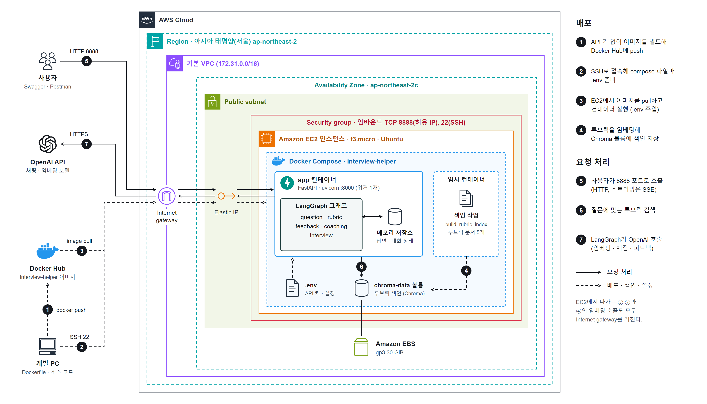
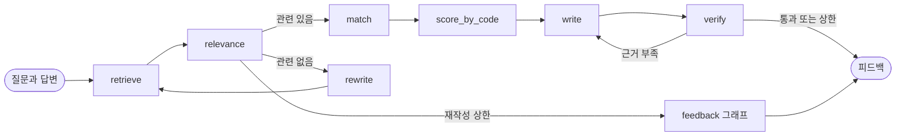

# interview-coach-server

면접 답변을 저장하고, LLM이 면접관처럼 채점하고 코칭하는 FastAPI 서버입니다. LLM 흐름은 LangChain 체인과 LangGraph 그래프로 구성했습니다.

- **피드백**: 질문, 답변, 자신감(1~5)을 등록하면 점수(0~100)와 피드백을 돌려줍니다. 주제에 맞는 루브릭 문서가 있으면 그 문서를 근거로 채점합니다(RAG).
- **스트리밍**: 피드백 본문을 SSE로 받아 볼 수 있습니다.
- **재답변 코칭**: 답변을 고쳐 다시 내면 이전 답변과 비교해 나아진 점과 다음에 보완할 점을 알려 줍니다.
- **모의 면접**: 답변 수준에 따라 꼬리 질문이나 힌트 질문이 이어지고, 끝나면 종합 리포트를 줍니다.
- **질문 생성**: 연습할 백엔드 기술 면접 질문을 만들어 줍니다.

## 아키텍처



- **인프라**: AWS 서울 리전의 기본 VPC 퍼블릭 서브넷에 EC2(t3.micro, Ubuntu) 한 대를 두고 Elastic IP를 연결했습니다. 인터넷 통신은 Internet gateway를 거치고, 보안 그룹은 인바운드 8888(허용 IP)과 22(SSH)만 엽니다.
- **컨테이너**: Docker Compose로 app 컨테이너를 실행하고 호스트 8888을 컨테이너 8000에 연결합니다. 루브릭 색인은 임시 컨테이너가 한 번 만듭니다.
- **코드 의존 방향**: `api/routes → services → repositories / agents`, `agents → shared → core`. 아래 계층은 위 계층을 import하지 않습니다.
- **데이터**: 답변(`AnswerRepository`)과 코칭·면접 상태(`InMemorySaver`)는 메모리에 있어 서버를 다시 시작하면 사라집니다. 그래서 워커도 1개만 사용합니다. 루브릭 색인은 EBS에 있는 `chroma-data` 볼륨에 남습니다.
- **배포**: API 키가 없는 이미지를 Docker Hub에 올리고, EC2에서 컨테이너를 만들 때 `.env`의 값을 넣습니다.

그림 원본은 [assets/architecture.svg](assets/architecture.svg)이고, AWS 공식 아키텍처 아이콘(2025.07.31)을 사용했습니다.

### LangGraph 그래프

| 그래프 | 흐름 | 반복 상한 (기본값) |
| --- | --- | --- |
| `question` | 생성 → 검증(한 문장, 주제) → 미통과면 재생성 | 생성 2회 |
| `rubric` | 검색 → 관련성 판정 → (없으면 검색어 재작성) → 개념 대조 → 코드로 점수 계산 → 작성 → 근거 검증 → (근거가 부족하면 재작성) | 검색어 재작성 2회, 작성 2회 |
| `feedback` | 작성 → 분석(점수, 구조화) → 검토 → 미통과면 재작성 또는 재분석 | 검토 2회 |
| `coaching` | 채점 → 이전 답변과 비교 → 코칭, 또는 종료 요약 | 원래 답변 포함 3회, 목표 80점 |
| `interview` | 질문 → 답변 채점 → 꼬리 질문 / 힌트 질문 / 새 주제 / 종합 리포트 | 주제당 깊이 2, 전체 6문항 |

피드백 API는 `rubric` 그래프를 먼저 실행하고, 관련 루브릭을 찾지 못하면 `feedback` 그래프로 대신합니다.



## 기술 스택

| 구분 | 사용 기술 |
| --- | --- |
| 언어 / 패키지 관리 | Python 3.14, uv |
| 웹 프레임워크 | FastAPI (`fastapi[standard]`) |
| LLM | LangChain, LangGraph, OpenAI (`langchain-openai`) |
| RAG | Chroma (`langchain-chroma`), `langchain-text-splitters`, OpenAI 임베딩 |
| 설정 | pydantic-settings |
| 저장소 | 메모리 딕셔너리, LangGraph `InMemorySaver`, Chroma |
| 배포 | Docker, Docker Compose, Docker Hub, AWS EC2 |

## 실행 방법

1. 의존성을 설치합니다.

   ```bash
   uv sync
   ```

2. `.env.example`을 복사해 `.env`를 만들고, `OPENAI_API_KEY`에 본인의 키를 넣습니다.

   ```bash
   cp .env.example .env
   ```

   키는 시스템 환경 변수 `OPENAI_API_KEY`로 설정해도 됩니다. 둘 다 있으면 시스템 환경 변수를 사용합니다.

3. 루브릭 색인을 만듭니다. 처음 한 번, 그리고 `data/rubrics/`를 고쳤을 때 실행합니다. 임베딩 API를 호출합니다.

   ```bash
   uv run python -m scripts.build_rubric_index
   ```

4. 서버를 실행합니다.

   ```bash
   uv run fastapi dev
   ```

5. 브라우저에서 http://127.0.0.1:8000/docs 를 열어 API를 호출합니다.

### 키 없이 실행하기 (가짜 LLM)

`FAKE_LLM=true`로 설정하거나 `OPENAI_API_KEY`를 어디에도 두지 않으면 OpenAI를 호출하지 않습니다. `.env`에서는 값을 비우지 말고 줄을 지웁니다. 비용 없이 API 흐름만 확인할 때 사용하며, 루브릭 색인도 필요 없습니다.

## Docker

이미지를 만듭니다. 빌드 컨텍스트는 프로젝트 루트입니다.

```bash
docker build -f docker/Dockerfile --platform linux/amd64 -t <DOCKERHUB_USER>/interview-helper:1.0.0 .
```

로컬에서 색인을 만들고 실행합니다. 키를 시스템 환경 변수에만 두었다면 두 명령에 `-e OPENAI_API_KEY`를 붙입니다.

```bash
docker run --rm --env-file .env -v interview-chroma:/app/chroma_db <DOCKERHUB_USER>/interview-helper:1.0.0 python -m scripts.build_rubric_index
docker run --rm -p 8000:8000 --env-file .env -v interview-chroma:/app/chroma_db <DOCKERHUB_USER>/interview-helper:1.0.0
```

### EC2 배포

1. 이미지를 올립니다.

   ```bash
   docker push <DOCKERHUB_USER>/interview-helper:1.0.0
   ```

2. 서버의 같은 폴더에 `docker/compose.deploy.yaml`과 `.env`를 둡니다.

   ```dotenv
   DOCKERHUB_USER=<DOCKERHUB_USER>
   IMAGE_TAG=1.0.0
   OPENAI_API_KEY=<OPENAI_API_KEY>
   ```

3. 서버에서 이미지를 받고, 색인을 만든 뒤 실행합니다. `http://<서버 주소>:8888/docs`로 접속합니다.

   ```bash
   docker compose -f compose.deploy.yaml pull
   docker compose -f compose.deploy.yaml run --rm app python -m scripts.build_rubric_index
   docker compose -f compose.deploy.yaml up -d
   ```

4. 내릴 때는 다음 명령을 사용합니다. 색인 볼륨은 남습니다(`-v`를 붙이면 삭제).

   ```bash
   docker compose -f compose.deploy.yaml down
   ```

`.env`는 이미지에 들어가지 않고 컨테이너를 만들 때만 전달됩니다. 로그인과 요청 횟수 제한이 없으므로 8888 포트는 허용할 IP로 제한합니다.

## 환경 변수

| 이름 | 기본값 | 설명 |
| --- | --- | --- |
| `OPENAI_API_KEY` | 없음 | OpenAI API 키. 없으면 가짜 LLM으로 실행됩니다. |
| `OPENAI_MODEL` | `gpt-6-luna` | 채팅 모델 |
| `OPENAI_REASONING_EFFORT` | `none` | 추론 정도 (`none`, `minimal`, `low`, `medium`, `high`, `xhigh`) |
| `OPENAI_MAX_OUTPUT_TOKENS` | `1000` | 출력 토큰 상한 |
| `OPENAI_TIMEOUT_SECONDS` | `30` | OpenAI 응답을 기다리는 최대 시간(초) |
| `EMBEDDING_MODEL` | `text-embedding-3-large` | 임베딩 모델. 바꾸면 색인을 다시 만듭니다. |
| `FAKE_LLM` | `false` | `true`면 키가 있어도 가짜 LLM을 사용합니다. |
| `FAKE_LLM_DELAY_SECONDS` | `3` | 가짜 LLM이 응답하기 전에 기다리는 시간(초) |
| `FEEDBACK_MAX_REVIEWS` | `2` | 피드백 검토 상한 |
| `QUESTION_MAX_REGENERATIONS` | `2` | 질문 생성 상한 |
| `RAG_TOP_K` | `3` | 검색할 루브릭 수 |
| `RAG_MAX_REWRITES` | `2` | 검색어 재작성 상한 |
| `RAG_MAX_GENERATIONS` | `2` | 루브릭 피드백 작성 상한 |
| `RETRY_MAX_ATTEMPTS` | `3` | 재답변 시도 상한 (원래 답변 포함) |
| `RETRY_TARGET_SCORE` | `80` | 코칭을 끝내는 목표 점수 |
| `INTERVIEW_MAX_DEPTH` | `2` | 주제당 꼬리·힌트 질문 깊이 상한 |
| `INTERVIEW_MAX_TURNS` | `6` | 면접 전체 문항 상한 |
| `INTERVIEW_FOLLOW_UP_SCORE` | `70` | 꼬리 질문과 힌트 질문을 나누는 점수 |
| `THREAD_POOL_SIZE` | FastAPI 기본값 | (실험용) `def` 핸들러를 실행할 스레드 수 |

## API

| 메서드 | 경로 | 핸들러 | 설명 | 응답 |
| --- | --- | --- | --- | --- |
| `POST` | `/api/answers` | `def` | 면접 답변 등록 | 201, 422 |
| `GET` | `/api/answers` | `def` | 전체 답변 목록 조회 | 200 |
| `GET` | `/api/answers/{answer_id}` | `def` | 답변 하나 조회 | 200, 404 |
| `POST` | `/api/answers/{answer_id}/feedback` | `async def` | AI 피드백 생성 후 답변에 저장 | 200, 404, 502 |
| `POST` | `/api/answers/{answer_id}/feedback/stream` | `async def` | 피드백 스트리밍 (SSE) | 200, 404 |
| `POST` | `/api/answers/{answer_id}/retry` | `async def` | 답변을 고쳐 다시 내기 (코칭) | 200, 404, 409, 422, 502 |
| `POST` | `/api/questions` | `def` | 백엔드 기술 면접 질문 생성 | 200, 502 |
| `POST` | `/api/interviews` | `async def` | 모의 면접 시작, 첫 질문 | 201, 422, 502 |
| `POST` | `/api/interviews/{session_id}/answers` | `async def` | 면접 답변 제출, 다음 질문 또는 리포트 | 200, 404, 409, 422, 502 |
| `GET` | `/api/interviews/{session_id}` | `async def` | 면접 문답 기록 조회 | 200, 404 |

### 답변 등록 `POST /api/answers`

```json
{
  "userName": "둘리",
  "question": "FastAPI의 async def는 언제 사용하나요?",
  "answer": "I/O 대기가 많은 작업을 처리할 때 사용합니다.",
  "confidence": 3
}
```

| 필드 | 규칙 |
| --- | --- |
| `userName` | 1~10자 |
| `question` | 빈 값 불가 |
| `answer` | 1~300자 |
| `confidence` | 1 이상 5 이하 정수 |

규칙에 맞지 않으면 422로 응답합니다.

### 답변 조회 `GET /api/answers/{answer_id}`

```json
{
  "answerId": 1,
  "userName": "둘리",
  "question": "FastAPI의 async def는 언제 사용하나요?",
  "answer": "I/O 대기가 많은 작업을 처리할 때 사용합니다.",
  "confidence": 3,
  "feedback": null,
  "score": null
}
```

피드백을 받기 전에는 `feedback`과 `score`가 `null`입니다.

### 피드백 생성 `POST /api/answers/{answer_id}/feedback`

```json
{
  "feedback": "지연 로딩과 추가 쿼리의 관계를 잘 짚었습니다. ...",
  "score": 60,
  "strengths": ["추가 쿼리가 나가는 원인을 설명했습니다."],
  "missingConcepts": ["@EntityGraph", "즉시 로딩의 한계"],
  "followUpQuestions": [],
  "coveredConcepts": ["지연 로딩과 추가 쿼리", "fetch join", "batch size"],
  "sources": ["jpa_n_plus_1.md"]
}
```

- 관련 루브릭이 있으면 LLM은 답변에 나온 개념만 판정하고, **점수와 빠진 개념은 코드가 계산합니다**(나온 개념 수 ÷ 핵심 개념 수).
- 관련 루브릭이 없으면 LLM이 점수를 매기고, `coveredConcepts`와 `sources`는 빈 리스트입니다.
- 자신감은 말투에만 반영합니다. 2 이하는 격려로 시작하고, 4 이상은 `followUpQuestions`에 꼬리 질문을 담습니다.

### 피드백 스트리밍 `POST /api/answers/{answer_id}/feedback/stream`

| 이벤트 | 데이터 |
| --- | --- |
| `token` | 피드백 본문 조각 `{"text": "..."}` |
| `result` | 최종 결과 (피드백 응답과 같은 형태) |
| `error` | LLM 호출 실패 `{"code": "ERROR_CODE_00011", "detail": "..."}` |

스트리밍은 `feedback` 그래프만 사용하고, 루브릭 채점과 검토 후 재작성은 하지 않습니다.

```bash
curl -N -X POST http://127.0.0.1:8000/api/answers/2/feedback/stream
```

### 재답변 코칭 `POST /api/answers/{answer_id}/retry`

먼저 피드백을 받은 답변만 다시 낼 수 있습니다.

```json
{ "answer": "fetch join이나 @EntityGraph로 한 번에 조회해 해결합니다." }
```

```json
{
  "attempt": 2,
  "score": 72,
  "scoreDelta": 12,
  "feedback": "...",
  "missingConcepts": ["즉시 로딩의 한계"],
  "improvements": ["@EntityGraph를 추가로 설명했습니다."],
  "nextFocus": "즉시 로딩으로 바꿔도 해결되지 않는 이유를 설명해 보세요.",
  "finished": false,
  "summary": null
}
```

목표 점수나 시도 상한에 도달하면 `finished`가 `true`가 되고 `summary`를 돌려줍니다.

### 모의 면접 `/api/interviews`

시작할 때 `topics`(1~3개)를 생략하면 주제 2개를 무작위로 고릅니다.

```json
{ "userName": "둘리", "topics": ["JPA N+1 문제"] }
```

답변은 `POST /api/interviews/{session_id}/answers`로 냅니다.

```json
{ "answer": "목록을 조회한 뒤 연관 엔티티마다 쿼리가 더 나가는 문제입니다." }
```

```json
{
  "sessionId": "0b8f...",
  "turn": 2,
  "topic": "JPA N+1 문제",
  "depth": 1,
  "previousGrade": { "score": 75, "comment": "...", "missingConcepts": ["batch size"] },
  "question": "fetch join에 페이징을 함께 쓰면 어떤 문제가 있나요?",
  "questionType": "FOLLOW_UP",
  "finished": false,
  "report": null
}
```

`questionType`은 `MAIN`(새 주제), `FOLLOW_UP`(꼬리 질문), `HINT`(힌트 질문)입니다. 면접이 끝나면 `finished`가 `true`가 되고 `report`에 평균 점수, 강한 주제, 약한 개념, 총평이 담깁니다.

### 질문 생성 `POST /api/questions`

```json
{
  "question": "JPA에서 N+1 문제가 발생하는 원인과 해결 방법을 설명해 주세요."
}
```

받은 질문에 답한 뒤 `POST /api/answers`로 등록하면 피드백을 받을 수 있습니다.

### 에러 응답

```json
{
  "code": "ERROR_CODE_00001",
  "description": "조회 실패",
  "detail": "해당 답변이 존재하지 않습니다. answer_id=999"
}
```

| 상태 코드 | 코드 | 상황 |
| --- | --- | --- |
| 404 | `ERROR_CODE_00001` | 없는 답변을 요청한 경우 |
| 409 | `ERROR_CODE_00002` | 피드백을 받기 전에 재답변을 낸 경우 |
| 409 | `ERROR_CODE_00003` | 코칭이 끝났거나 시도 상한에 도달한 경우 |
| 404 | `ERROR_CODE_00004` | 없는 면접 세션을 요청한 경우 |
| 409 | `ERROR_CODE_00005` | 이미 끝난 면접에 답변한 경우 |
| 502 | `ERROR_CODE_00011` | OpenAI 호출 실패 또는 구조화 출력 파싱 실패 |

## 프로젝트 구조

```text
app/
    main.py                  # lifespan(AI 구성 요소 생성), 예외 처리기, 라우터 등록
    api/
        dependencies.py      # 저장소, AI 구성 요소, 서비스 의존성 함수
        routes/              # answers, questions, interviews
    schemas/                 # API DTO (camelCase)
    core/
        config.py            # 환경 변수 설정 (pydantic-settings)
        exceptions.py        # 404/409/502 예외와 처리기
        thread_log.py        # 실행 스레드 이름 출력
    domain/
        answer.py            # 면접 답변 엔티티
    repositories/
        answer_repository.py # 딕셔너리 저장소
    services/                # answer, feedback, question, coaching, interview
    shared/                  # 그래프와 서비스가 같이 쓰는 LLM 공용 모듈
        models.py            # 채팅 모델, 임베딩 생성
        errors.py            # OpenAI/파싱 예외 → AiRequestError
        callbacks.py         # 토큰 사용량 기록
        data.py              # 루브릭 문서 로드, 핵심 개념 추출
        retrieval.py         # Chroma 벡터 저장소
    agents/                  # 기능별 LangGraph 패키지
        components.py        # 그래프 조립
        fakes.py             # 가짜 그래프와 모델
        question/            # 각 패키지: outputs, prompts, state, graph
        rubric/
        feedback/
        coaching/
        interview/
data/rubrics/                # 주제별 루브릭 문서 (RAG 원본)
scripts/
    build_rubric_index.py    # 루브릭 색인 생성
docker/                      # Dockerfile, Dockerfile.dockerignore, compose.deploy.yaml
assets/                      # 아키텍처 그림
```

## 설계 포인트

- **LLM 호출이 이벤트 루프를 막지 않습니다.** 피드백, 코칭, 면접은 `async def`와 `ainvoke()`/`astream()`으로 처리합니다. 질문 생성은 `def`와 `invoke()`로 남겨 스레드 풀에서 실행되는 것을 비교할 수 있습니다. 로그의 스레드 이름으로 확인합니다.
- **모델과 그래프는 서버 시작 때 한 번만 만듭니다.** lifespan에서 `build_ai_components()`로 만들어 `app.state.ai`에 저장하고, 서비스에는 필요한 그래프만 주입합니다.
- **모든 루프에 상한이 있습니다.** 재작성, 재검색, 코칭, 면접의 상한을 설정으로 관리해 과금을 막습니다.
- **숫자는 코드가 계산합니다.** 루브릭 점수, 점수 변화량, 면접 평균 점수는 LLM에 맡기지 않습니다.
- **사람을 기다리는 루프는 요청 단위로 나눕니다.** 코칭과 면접은 요청 하나에 한 단계씩 진행하고, 체크포인터와 `thread_id`(`retry-{answer_id}`, `interview-{session_id}`)로 상태를 이어 갑니다.
- **API DTO와 LLM 출력 스키마를 분리합니다.** 서비스가 LLM 출력을 API 응답으로 바꿉니다.
- **외부 서버의 실패는 502로 구분합니다.** OpenAI 예외와 파싱 실패를 `shared/errors.py` 한곳에서 `AiRequestError`로 바꿉니다.
